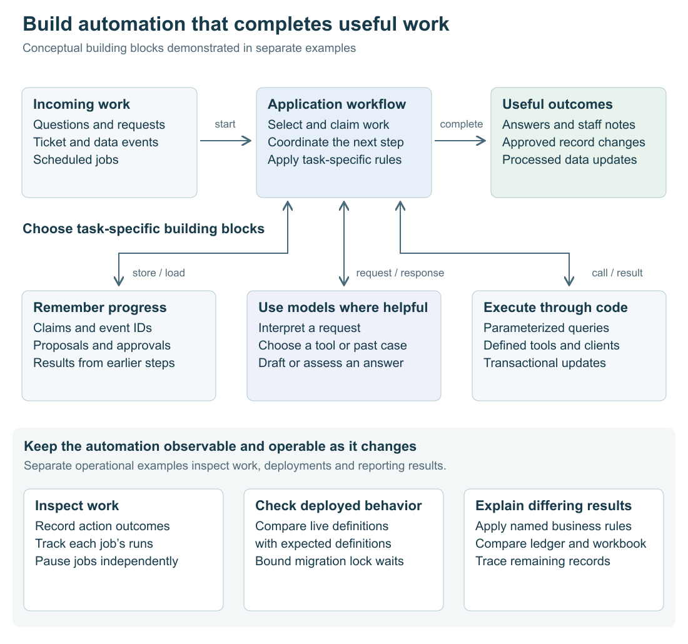

> **This is an example repo, not a library.** It exists to show one idea from an internal
> system, rebuilt over synthetic data so the idea can be read and run. It is not maintained
> as a dependency, not hardened for production, and the data in it is invented. Study the concepts;
> code reuse requires permission.

# Building an automation system

## Situation

A support ticket arrives and needs an initial investigation. A colleague asks about an account's open deals. A manager wants to transfer several accounts to a new owner. In the background, customer records need updating and financial reports need reconciling.

People do this work by gathering information, deciding what it means, updating records, and checking the result. Automation can take over much of that preparation and execution, while leaving people involved where their judgment or approval matters.

## Complication

A useful automation system needs more than a model response or a scheduled script. An account investigation may require several database lookups. A change request may wait for a person's approval. An incoming event may be delivered twice. An optional job may need pausing while essential updates continue.

The system also keeps changing after it starts running. A corrected database definition can exist in code without reaching the live database. A migration can hold up reports while waiting for a lock. A completed calculation can disagree with finance for reasons that need explaining, not simply overwriting.

The challenge is to connect incoming work to useful outcomes—and keep those workflows understandable and dependable as they run and change.

## Our Answer

The examples explore three connected decisions: **how work enters the system, how it progresses to an outcome, and how to operate it over time.** Models handle language interpretation and proposed answers; application code owns database operations, workflow state, and execution decisions.

The repository contains two runnable collections: [AI-assisted workflows](examples/ai-workflows/README.md) and [data operations](examples/data-operations/README.md). They demonstrate building blocks of this design separately, rather than a single deployed engine with every component connected.

### 1. Give incoming work a clear execution path

Start with the work someone wants done. Different inputs need different entry points, but each should lead to a defined task and a useful result.

| Incoming work | Steps the example performs | Useful result |
| --- | --- | --- |
| Unanswered product question | Claim the question, draft an answer, check whether it can be posted | An answer in the thread or a recorded refusal |
| Account question | Find the account, read its deals and tickets, interpret the results | An answer or clarification |
| Account reassignment request | Interpret the request, select accounts, store a proposal, wait for confirmation | Approved owner changes |
| New support ticket | Store the event, retrieve similar past cases, prepare suggested checks | An internal note for the support specialist |
| Incoming data event | Store and acknowledge delivery, then process the stored event | A recorded database effect |
| Scheduled work | Read schedules and job settings, run due jobs, record results | Independently controlled sync and duplicate-detection work |

A model is useful where wording needs interpretation. The **planner** converts an account reassignment request into a current owner, region, and destination owner. Application SQL resolves that filter into actual accounts. The **analyst** chooses named tools to investigate an account; the application executes their parameterized queries and returns results for the next model step.

Other roles serve other tasks: a **drafter** prepares product answers, a **relevance judge** checks whether they address the question, and a **triage assistant** selects a related support case and suggests a follow-up question. The AI examples use prepared responses in `ScriptedModel` so these workflows run repeatably without an LLM API connection.

Routine event and scheduling decisions use ordinary code. A receiver verifies an event's signature, stores its ID and body, then acknowledges delivery without waiting for processing. A dispatcher examines each job's schedule and last start time to decide whether it is due. Looking for scheduled times since the last start, rather than matching only the current minute, lets a late tick still pick up due work.

The distinction is practical: ask a model to interpret or propose; give the application an explicit path for carrying that proposal into a result.

[Model roles](examples/ai-workflows/src/model.ts) · [Analyst and tools](examples/ai-workflows/src/analyst.ts) · [Event receiver](examples/data-operations/src/landing.ts) · [Dispatcher](examples/data-operations/src/dispatch.ts)

### 2. Carry the task through to a useful outcome

Work often spans several steps. The application needs to remember what it has already read, what a person reviewed, and which effects have already happened.

For an account investigation, it keeps the conversation and tool results. The analyst can first find the account and then request its deals and tickets together. The loop counts executed tool calls and, after six, requests a conclusion without further tools. If the budget is crossed midway through several requested calls, each still receives a result: data for executed calls and a budget error for the others. This preserves the conversation while bringing the investigation to a stopping point.

For a reassignment, the important state is the exact proposal the person saw. The server stores it under a `turn_id`; confirmation refers to that proposal. In the example, approval for three accounts cannot become an update to ten because a model expanded the list. A session transaction lock coordinates new proposals and confirmations, and conditional updates prevent repeated application or overwriting an owner changed in the meantime.

For incoming events, progress belongs in the database. A worker claims an unhandled event using `FOR UPDATE SKIP LOCKED`, allowing overlapping workers to take different records. The event's database effect and handled flag commit together. Unique event IDs identify repeated deliveries, and the example effect is also keyed by event ID so replay does not repeat it. `NOTIFY` wakes the listener; the same drain function can separately process stored backlog.

Completion also depends on the job. Support preparation produces an internal note through a client that exposes only `addNote`, leaving customer contact to the specialist. Product answers pass source, confidence, phrase, and relevance checks before posting, with eligible overflow beyond three posts deferred to another run. These checks establish posting eligibility; they do not verify every statement against its cited source.

The AI workflows record action outcomes in a ledger; scheduled jobs record their runs separately. Stored proposals, event records, claims, and logs turn a sequence of calls into work whose progress and result can be inspected.

[Confirmed changes](examples/ai-workflows/src/changes.ts) · [Support preparation](examples/ai-workflows/src/triage.ts) · [Answer posting](examples/ai-workflows/src/questions.ts) · [Transactional event processing](examples/data-operations/src/landing.ts)

### 3. Keep the automation working as it changes

Once people depend on a workflow, changing it becomes part of the system's design.

First, separate work that needs separate controls. Customer sync and duplicate detection have independent job names and switches. Pausing the optional check leaves the sync running. The dispatcher records runs and exposes expected jobs with no recorded execution. If it cannot read the switch configuration, it starts nothing rather than accidentally restarting disabled work.

Next, inspect the running system, not just its files. Editing an already-applied migration changes what a fresh database builds, while the live runner skips that recorded filename. The example rebuilds migrations in a scratch schema and compares live view and function definitions with the result. Related checks find columns missing their intended defaults and views that still return a `NULL` placeholder despite newly available source data.

Applying a correction should also respect current users. An exclusive-lock request from a waiting migration can make later readers queue behind it. A short transaction-local `lock_timeout` makes the migration roll back and retry after a pause, releasing that obstacle rather than waiting indefinitely. The limit bounds lock waits, not the duration of legitimate work after a lock is acquired.

Finally, check whether outputs mean what people expect. The finance example compares a revenue ledger with a workbook. It applies explicit rules for services revenue and returning customers to the comparison without changing the ledger's original categories. Agreement improves from 1 of 12 quarters to 4, then 10. Comparing individual deal records traces the remainder to six missing company links. A matching total alone could have concealed errors that cancel out.

These mechanisms connect an operational symptom to something actionable: a disabled job, an unapplied definition, a waiting migration, or a missing source relationship. They support improving the automation without losing sight of the work it serves.

[Live-definition comparison](examples/data-operations/src/drift.ts) · [Column defaults](examples/data-operations/src/defaults.ts) · [Placeholders](examples/data-operations/src/stubs.ts) · [Migration execution](examples/data-operations/src/migrate.ts) · [Reconciliation](examples/data-operations/src/reconcile.ts)

## Why this matters to users

- **Less work carrying tasks between steps.** Account investigations gather records, support tickets receive prepared checks, and approved reassignments update the selected accounts.
- **Help without surrendering every decision.** People review account changes and retain control of customer communication while automation does the preparation.
- **Repeated delivery need not mean repeated work.** Stored event and proposal identities let the application recognize retries and completed actions.
- **Essential work can continue while other work changes.** Independent job controls and bounded migration waits reduce unnecessary interruptions to updates and reports.
- **Problems lead to specific next actions.** Recorded outcomes and comparisons help explain why work stopped or why figures disagree, instead of leaving users with an unexplained failure or total.

## Explore the example

[Run the examples](docs/running.md) · [AI workflow guide](examples/ai-workflows/README.md) · [Data operations guide](examples/data-operations/README.md)

Copyright © 2026 Geoffrey Lew. All rights reserved.
