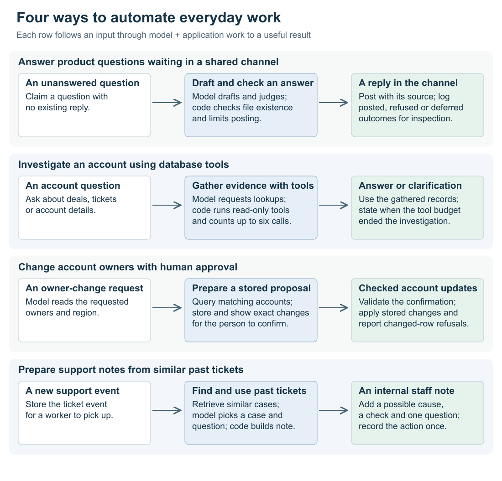
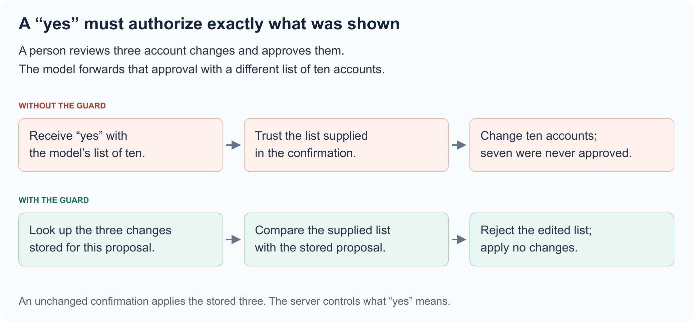

[Back to the automation-system overview](../../../README.md)

> **This is an example repo, not a library.** It exists to show one idea from an internal
> system, rebuilt over synthetic data so the idea can be read and run. It is not maintained
> as a dependency, not hardened for production, and the data in it is invented. Study the concepts;
> code reuse requires permission.

# Automating business tasks with AI agents

## Situation

Routine work arrives in different forms. A product question sits unanswered in a shared channel. A colleague asks for an account's open deals and support tickets. A manager needs to transfer several accounts to another owner. A new support ticket needs an initial investigation.

People handle these tasks by reading the request, gathering information, deciding what to do, and updating a record or responding. Much of that preparation is repeatable, even though the request is written in everyday language.

This example explores **building automation systems that carry out that work**, combining model tasks with database queries, application logic, and human decisions.

## Complication

Generating a useful sentence is only one step. An account investigation needs several lookups. Reassigning accounts needs a concrete list to review and a later confirmation. Support preparation needs relevant past tickets, somewhere to save the findings, and a way to recognize an event that has already been processed.

The application must connect those steps. It also needs to distinguish a suggestion from a completed action: a model proposing a customer reply does not mean the user asked it to send one. A stalled investigation should still produce a useful conclusion, and a repeated request should not repeat a completed change.

## Our Answer

The repository implements four separate workflows. They illustrate recurring decisions in building automation; they do not run as one combined agent.

| Work to automate | Model's contribution | Application's contribution | Result |
| --- | --- | --- | --- |
| Unanswered product questions | Draft an answer and judge its relevance | Find unanswered messages, check drafts, control posting | An answer in the question's thread, or a recorded refusal |
| Account investigation | Choose lookups and interpret their results | Execute defined tools and manage the conversation | An answer or a clarification |
| Account reassignment | Interpret the requested change | Select accounts, store a proposal, apply confirmed changes | Updated owners and a report of any rows refused |
| Support preparation | Select a related past ticket and suggest a question | Retrieve examples, compose an internal note, process the event once | Suggested checks for the support specialist |

These are LLM roles: planner, analyst, drafter, relevance judge, and triage assistant. [model.ts](../src/model.ts) supplies them through `ScriptedModel`, using prepared responses so the workflows and their failure cases run repeatably without an LLM API connection. PostgreSQL stores the example messages, tickets, accounts, and workflow state.

### 1. Turn incoming work into a defined task

Start with the product-question workflow. It scans stored channel messages for unanswered questions and claims each one before preparing an answer. The **drafter** returns answer text, a confidence value, and a source path. Those fields give the application something concrete to evaluate before posting in the thread.

Support preparation starts differently: a receiver stores a ticket event under its event ID. The worker compares the ticket's wording with resolved tickets and retrieves up to three close matches. It uses word overlap rather than embeddings. The **triage assistant** selects a match and proposes a question; the application builds a note containing the possible cause, a customer-side check, and references to the past tickets.

For account administration, the **planner** turns “Move Lee's EMEA accounts to Priya” into a filter: current owner, region, and destination owner. Application SQL then selects the actual accounts. The model interprets the request; the database determines which records match it.

The common design choice is to make the model's job specific. It proposes an interpretation, a selection, or a draft that the rest of the workflow can use. The surrounding code supplies records and determines how that output becomes work.

[Question discovery and drafts](../src/questions.ts) · [Ticket retrieval and notes](../src/triage.ts) · [Reassignment planning](../src/changes.ts)

### 2. Coordinate the steps and remember what has happened

Some tasks need a conversation with tools. For “What open deals does this account have, and how many open tickets?”, the **analyst** first requests the account record. It then requests the deals and tickets using the account ID. The application executes those named tools through parameterized SQL in read-only transactions, returns their results to the model, and continues until it receives an answer.

The tool descriptions define what the analyst can investigate. If someone asks whether support load has increased, today's open and resolved tickets cannot establish a historical trend. The loop permits six executed tool calls, then requests a conclusion with no further tools available. A forced answer identifies the spent budget. If the response contains a clarification alongside a guessed answer, the parser keeps the question and drops the guess.

There is a protocol detail behind this handoff: a model may request several tools at once and cross the budget midway through the group. Every requested call still receives a result—data for executed calls and an error for the rest—in one message before the conclusion request. Stopping the loop without those results would leave the conversation incomplete.

Other tasks need durable state between interactions. Reassignment stores the selected accounts as a proposal with a `turn_id`. The person can review it and confirm later. The application uses that ID to find the stored changes instead of rebuilding the list from the confirmation message.

Support processing also remembers progress. The receiver deduplicates event IDs, and the worker writes the note and marks the event processed in one transaction. An event key on the note prevents a repeated write from producing another copy. Product questions use claims and statuses to distinguish work already answered, refused, or available for another run.

These different forms of state—tool results, proposals, event records, and claims—let automation continue across steps without treating every invocation as a fresh task.

[Analyst conversation loop](../src/analyst.ts) · [Proposal state](../src/changes.ts) · [Stored workflow records](../src/schema.sql)

### 3. Complete the work through the right action

The final step depends on what the user delegated. An account transfer changes records, so its confirmation must apply to the accounts the person reviewed. In the example, the person sees three accounts, but the model passes back ten. The application refuses the expanded list; confirming the stored proposal applies the original three.

Concurrency matters here too. Proposing and confirming take a PostgreSQL transaction lock for the session, preventing a newer proposal from slipping between the latest-proposal check and the claim to apply it. A conditional update permits only one application. Each account update also checks its previous owner, so a change made in the meantime is reported instead of overwritten.

Support preparation ends with an internal note. The worker constructs a client with an `addNote` method and no customer-reply method. That gives the specialist a suggested check and question while leaving customer communication to them.

The product bot can post directly, so it first requires a nonempty draft, sufficient reported confidence, and a source file inside the product repository. Phrase checks filter guesses and announcements before a **relevance judge** assesses whether the answer addresses the question. At most three answers post per run; eligible overflow is released for a later run. A judge outage also releases the question for retry.

This review checks whether an answer is eligible to post, not whether every claim agrees with its source. The example includes an answer claiming 600 requests per minute where the source says 300; it passes the existing checks. That concrete failure identifies where source verification would add value.

Each workflow records action outcomes in a shared ledger: what was applied, posted, deferred, refused, or withheld. Together, the application steps turn model output into completed, reviewable work rather than leaving the user to carry out every suggestion manually.

[Applying confirmed changes](../src/changes.ts) · [Posting decisions](../src/questions.ts) · [Action ledger](../src/db.ts) · [Workflow tests](../test/agents.test.ts)

## Why this matters to users

- **Less routine preparation.** Product questions can receive an answer without someone manually picking them up; account investigations assemble information through several lookups.
- **A head start on support cases.** Specialists receive relevant past cases, a suggested check, and a question to ask, while retaining control of customer contact.
- **Less manual account administration.** Users can describe a reassignment, review the selected accounts, and approve the changes instead of editing each record themselves.
- **Delegation with a visible outcome.** Work ends in an answer, note, applied change, or explicit reason it did not proceed. Repeated events and confirmations are recognized rather than blindly performed again.

## Explore the example

[Run it](../docs/running.md) · [Implementation and tradeoffs](../docs/mechanisms.md) · [Detailed limits](../docs/limits.md)

Copyright © 2026 Geoffrey Lew. All rights reserved.
