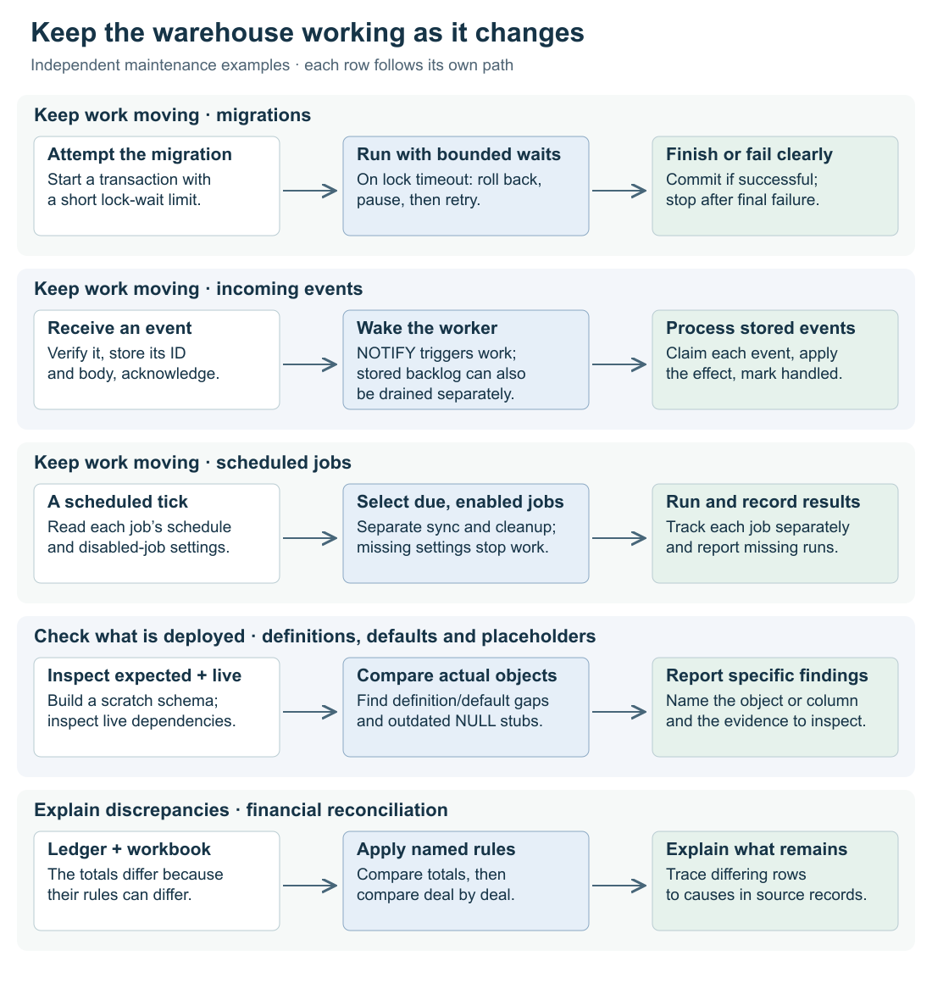
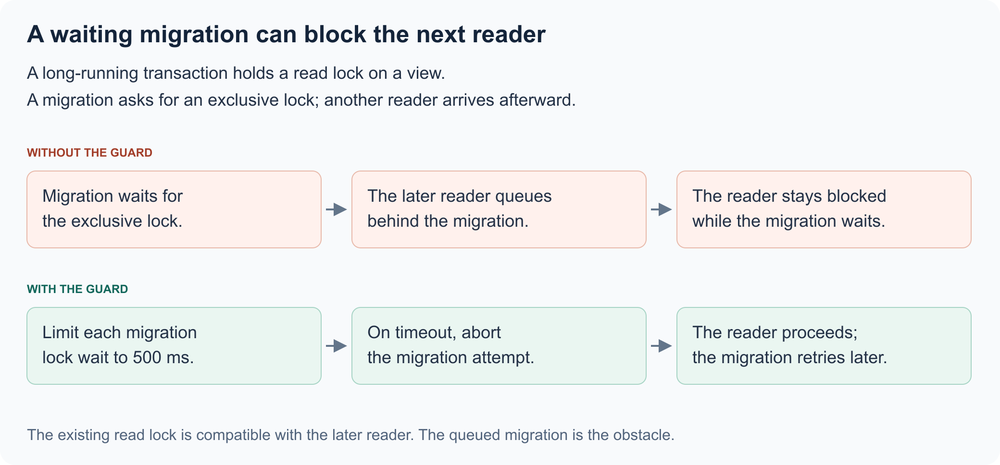

[Back to the automation-system overview](../../../README.md)

> **This is an example repo, not a library.** It exists to show one idea from an internal
> system, rebuilt over synthetic data so the idea can be read and run. It is not maintained
> as a dependency, not hardened for production, and the data in it is invented. Study the concepts;
> code reuse requires permission.

# Operating a live warehouse

## Situation

People use a warehouse while it changes. They read reports, receive updates from connected systems, and compare financial results with existing workbooks. Meanwhile, someone needs to change a database view, repair old records, or pause an optional background job.

The challenge is to make those changes without interrupting the work people already depend on.

## Complication

A change can look successful in isolation and still cause trouble in the running system. A migration waiting for a database lock can make dashboards wait behind it. A corrected view can pass tests on a new database while the live database keeps its old definition. A switch intended to pause duplicate detection can stop the customer sync as well.

Even a completed rebuild can produce numbers that disagree with finance. The difference might come from an intentional accounting rule—or from records that never made it into the calculation. A red total alone cannot tell us which.

## Our Answer

This repository explores three connected principles: **limit how maintenance interferes with ongoing work, check what is actually running, and turn discrepancies into explanations.** Separate PostgreSQL demonstrations make each failure and correction visible.

### 1. Keep maintenance from holding up everyday work

Imagine a report reads the `open_deals` view, then leaves its database transaction open. A migration tries to redefine that view and waits for an exclusive lock. Now another user opens the report.

That second read could run alongside the first. But the migration is ahead of it in the lock queue, so the new reader waits behind the waiting migration. A change that has done no work yet is already disrupting users.

The runner uses PostgreSQL's `lock_timeout` to limit each wait. If the lock is unavailable, it rolls back the transaction, pauses, and retries with increasing delays. `SET LOCAL` confines the timeout to that transaction. Only lock-timeout errors trigger this retry; other errors stop the run.

This differs from limiting the entire statement's duration: a large backfill may legitimately take time once it starts doing work. The lock limit targets the period spent waiting, when the migration can obstruct others without making progress. After the final failed attempt, the deployment fails. An optional monitoring connection records both the sessions blocking the migration and the readers queued behind it.

The same principle applies to incoming updates. If a webhook receiver performs slow processing before acknowledging delivery, the sender can time out and send the same event again while the first request is still working.

Here, the receiver verifies the signature, stores the event, and acknowledges it. A separate worker processes the stored events. The receiver's database role can insert but cannot read, update, or delete records. Unique event IDs prevent repeated deliveries from creating extra events; the example handler also keys its database effects by event ID, so replay does not repeat them.

Workers claim events with `FOR UPDATE SKIP LOCKED`, allowing overlapping drains to work on different events. Each event's database effect and handled flag commit in one transaction. `NOTIFY` wakes the listener promptly. The same `drain()` function can process stored backlog after missed notifications; scheduling it periodically would provide a backstop. A dry run executes the handler in a transaction that always rolls back, letting someone inspect a stored event's effect before replaying it.

Background controls need the same separation. The example gives customer sync and duplicate detection their own job names and switches. Pausing duplicate detection then leaves sync running. The dispatcher records each job's runs and reports when an expected job has no run recorded. If the switch configuration cannot be read, it runs nothing: a configuration failure must not accidentally restart a job someone deliberately stopped.

The common idea is to separate work by its consequences: waiting for maintenance, accepting an update, processing it, and pausing optional work should not unnecessarily block each other.

[Migration runner](../src/migrate.ts) · [Event storage and processing](../src/landing.ts) · [Job controls](../src/dispatch.ts)

### 2. Check the running database, not just the files describing it

Suppose a developer corrects a view by editing its original migration file. A test builds a new database from those files and passes. But the live migration runner has already recorded that filename and skips it. Users still see the old behavior.

The example builds the current migrations in an empty scratch schema, then compares its view and function definitions with the live schema. PostgreSQL supplies the definitions on both sides, making the comparison about the database objects rather than the appearance of the migration files. A new migration that reissues the corrected definition brings the live database into agreement.

The comparison preserves whitespace inside definitions because changing a string from `'a b'` to `'a  b'` changes its value. Making a diff look cleaner must not hide a real behavioral difference.

Other failures have the same shape: the database contains something different from what its setup code appears to promise. A copy tool can create columns without their intended defaults. Later, `ADD COLUMN IF NOT EXISTS` sees those columns and leaves them untouched.

In the example, new work orders consequently have a `NULL` revision. An update is allowed only when the stored revision matches the revision the caller read, which protects against overwriting someone else's edit. But comparing with `NULL` never succeeds, so these new orders cannot be updated through that path.

Building the baseline in a scratch schema exposes the missing defaults and required-value constraints. Repair also has to account for existing behavior: a trigger that increments the old revision would turn a backfill of zero back into `NULL + 1`. The generated repair temporarily disables user triggers around that backfill, then restores them before completing the column changes.

A view can also keep hiding data after its source improves. A placeholder such as `NULL::text AS product_type` always returns an empty value, even after the source gains a populated product-type column. The checker follows the view's dependencies through PostgreSQL's catalog, finds matching source columns, and reports how many records now have values. This gives the maintainer evidence to replace the placeholder; it does not guess the intended view definition.

These checks share a method: **compare the actual running state with a concrete expectation, then identify the specific difference that needs attention.** A successful fresh build alone cannot establish that users received the change.

[Deployed-definition comparison](../src/drift.ts) · [Defaults and repair](../src/defaults.ts) · [Outdated placeholders](../src/stubs.ts)

### 3. Explain discrepancies before trying to eliminate them

A newly rebuilt revenue ledger disagrees with a finance workbook. Should the ledger change, or is the workbook wrong?

First, the comparison needs to account for their different definitions. The workbook includes services revenue under expansion and counts returning former customers as new customers. The ledger preserves those categories separately.

The reconciliation applies each named workbook rule to a comparison of the ledger, one at a time. It keeps the ledger's original categories intact. In the synthetic example, agreement improves from **1 of 12 quarters** to **4**, then **10**. That progression shows which rule explains each improvement instead of silently changing the totals until they match.

The remaining differences need a different kind of investigation. A full join compares records by deal, booking date, and category, retaining records present on only one side. It then traces unmatched records back to their deal and company data. Six deals have no company link, so the ledger—which reads deals through companies—never includes them.

Comparing individual records matters even when a quarterly total agrees: two mistakes can cancel each other out. The report therefore supplies both the aggregate comparison and the remaining records with a cause. The next action becomes concrete: investigate missing company links, rather than adjust a financial total without knowing why.

[Reconciliation rules and record-level comparison](../src/reconcile.ts)

## Why this matters to users

- **Keep opening reports while maintenance waits.** Short lock waits limit how long a queued migration can hold readers behind it.
- **Receive updates without repeated actions.** Stored event IDs and transactional processing make retrying delivery safe for the database effects demonstrated here.
- **Pause optional work without losing essential updates.** Independent job controls let duplicate detection stop while customer sync continues.
- **See improvements reach the live system.** Comparisons expose corrections that exist in code but have not reached the database, along with old placeholders that still hide available information.
- **Resolve financial disagreements with specific evidence.** Named accounting rules explain expected differences; record-level findings identify the remaining deals to investigate.

## Explore the example

[Run it](../docs/running.md) · [Implementation and tradeoffs](../docs/mechanisms.md) · [Detailed limits](../docs/limits.md)

Copyright © 2026 Geoffrey Lew. All rights reserved.
